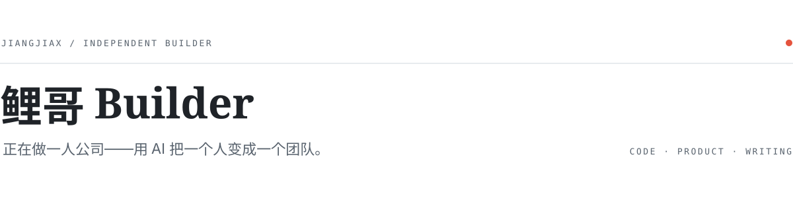

<picture>
  <source media="(prefers-color-scheme: dark)" srcset="./assets/header-dark.svg">
  
</picture>

我是鲤哥，软件工程师出身，现在一个人写代码、做产品、写内容。
AI 只负责执行和润色，观点和判断是我自己的。

> 一个人能认识到现实世界中的不完美，同时还能想到一种方式作出改进，同时还能实现自己的想法，当这三件事恰好发生在一个人身上时，他就可以改变世界。

 

### Selected work

| 项目 | 做什么 |
|---|---|
| **[counsel](https://github.com/jiangjiax/counsel)** | 多智能体决策辅助系统，用 Agent 复刻私董会全流程。小红书黑客松巅峰赛作品。 |
| **[li-skills](https://github.com/jiangjiax/li-skills)** | 我自己每天在用的内容生产 Claude Code skills：选题、深化、脚本、开头、封面。 |
| **[rational-emotive](https://github.com/jiangjiax/rational-emotive)** | 基于 REBT 的 AI skill，拆解焦虑和自我怀疑，配一个只在本地运行的私密面板。 |
| **[loop-engineering-kit](https://github.com/jiangjiax/loop-engineering-kit)** | 多阶段 agent loop 脚手架：验证者隔离、品味投票、全程不打断。 |
| **[Goalify](https://github.com/jiangjiax/Goalify)** | iOS 目标管理 App，把认知科学和行为心理学做进目标拆解与复盘。 |
| **[LiCourse](https://github.com/jiangjiax/LiCourse)** | 零基础 AI 全栈编程课。 |

### Playground

[moyu-aquarium](https://github.com/jiangjiax/moyu-aquarium) 挂在桌面底边的像素水族馆 ·
[whale-simulator](https://github.com/jiangjiax/whale-simulator) 一头座头鲸的 3D 治愈模拟 ·
[zero-shelter](https://github.com/jiangjiax/zero-shelter) Godot 4 的 3D 肉鸽

 

Claude Code · TypeScript · Go · Swift · Godot　—　小红书 @鲤哥builder
